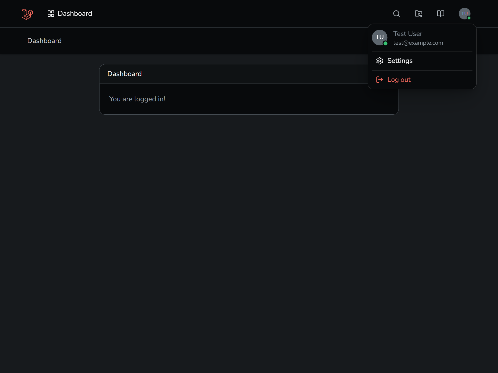

# Laravel + Bootstrap + Vue Starter Kit

## Introduction

Our Vue starter kit provides a robust, modern starting point for building Laravel applications with a Vue frontend using [Inertia](https://inertiajs.com).

This Vue starter kit utilizes Vue 3 and the Composition API, TypeScript, and the [Bootstrap 6](https://www.getbootstrap.com) component library.

## Official Documentation

Documentation for all Laravel starter kits can be found on the [Laravel website](https://laravel.com/docs/starter-kits).

## License

The Laravel + Bootstrap + Vue starter kit is open-sourced software licensed under the MIT license.
